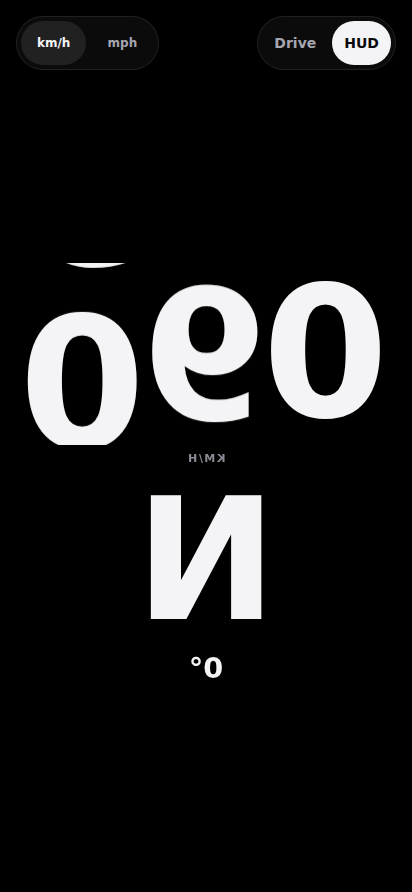
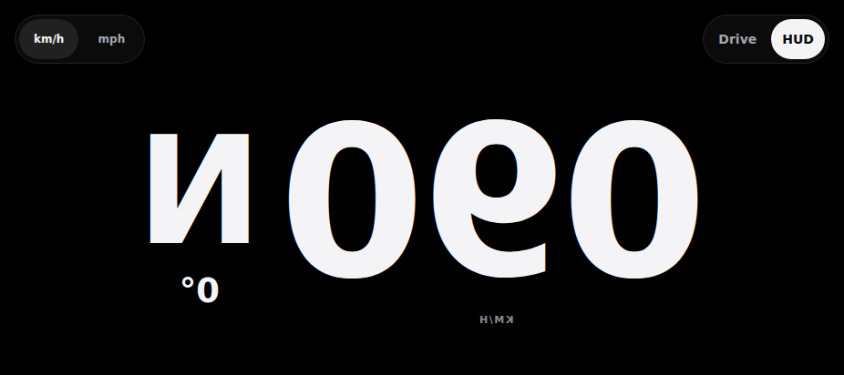

# DualDash

DualDash is a GPS speed HUD for your car. It runs on an Android phone. You mount the phone, open the app, and read your live speed and heading. Drive mode works on the dash. HUD mode works on the windshield. [SPEC: Purpose]

DualDash needs no OBD-II adapter, no car pairing, and no account. It reads GPS only. [SPEC: D2, Purpose]

DualDash grew from a cover-screen dashboard build. It now targets the dash and the windshield.

## Features

Every claim below is traced to the living spec (`docs/SPEC.md`) or the changelog (`CHANGELOG.md`).

- **Live speed readout.** Odometer-style digits roll to the newest GPS fix. Digits roll in the direction of travel: up when you speed up, down when you slow down. [SPEC: M1-O8, M2-O5]
- **Heading tape.** Drive mode shows a full-width tape. It has 10° ticks, the 8-point rose labelled every 45°, and a fixed centre index. The rose reads W-N-E: west sits left of north. [SPEC: M2-O6, M2-O11]
- **HUD windshield mode.** Speed and direction fill the screen at the largest legible size. The image is mirrored, so the windshield reflection reads right. Chrome hides after 3 seconds. A tap restores it. [SPEC: M2-O13, M2-O14]
- **Landscape and portrait.** The app follows the phone sensor in all four orientations, including reverse landscape. A rotation does not restart the GPS watch. [SPEC: M2-O12]
- **Over-speed alert.** Set a line with the ± 5 / ± 10 stepper. Cross it and the phone buzzes and the screen edge flashes. The alert re-fires at most every 15 seconds. [SPEC: M2-O3]
- **Session stats.** Start and stop a session by hand. The stop card shows distance, time, average speed, and max speed. The session pauses itself when you stop moving. Stats live in memory only. [SPEC: M2-O1]
- **Parked heading.** Below 3 m/s the tape follows the phone's own compass. It shows dimmed, because it is phone attitude, not direction of travel. [SPEC: M2-O9]
- **km/h and mph.** Toggle units in the app. The default is km/h. [SPEC: O2]
- **Honest signal states.** The app names each location state: needed, denied, off, searching, or signal lost. It never fakes 0.0. It holds the last good speed and marks it held. [SPEC: M1-O7, Completed in M1]
- **No nagging.** At most one "start session?" prompt per drive. Dismiss it and it stays silent for the whole drive. [SPEC: M2-O2]

## Screenshots

HUD windshield mode. The on-screen view is mirrored by design.

| HUD mode, portrait | HUD mode, chrome hidden after 3 s | HUD mode, landscape |
| --- | --- | --- |
|  |  |  |
| 412×892 | 412×892 | 926×412 |

Source: changelog entries for the v1.3 and v1.4 HUD builds (SPEC M2-O13, M2-O14).

## Install

DualDash is not on the Play Store. You sideload the APK.

1. Open the [Releases page](https://github.com/satwikgawand/dualdash/releases) and download the latest `dualdash-<version>-debug.apk`. If the page lists no APK yet, no build is published. Build from source instead (see below).
2. On the phone, allow your file manager or browser to install unknown apps.
3. Open the APK file and install.

Notes:

- The published builds are debug-signed. They are fine for your own device. They are not release-signed.
- Minimum Android version is Android 10 (API 29). [SPEC: M1-O1]
- DualDash shows speed for the driver. It is not a legal speedometer. [SPEC: Purpose]

## Build from source

Prerequisites: Node.js with npm, JDK 21, and the Android SDK.

```bash
npm ci                      # install exact versions from package-lock.json
npx vitest run              # unit suite — 367/367 at v1.4
npm run build               # tsc -b + vite build to dist/
npx tsc -b                  # standalone typecheck
npx cap sync                # copy web assets + plugin config into android/
```

Then build the APK. Set `JAVA_HOME` to a JDK 21 install and `ANDROID_HOME` to your Android SDK. Replace the placeholder paths below with your own paths:

```bash
export JAVA_HOME=/path/to/jdk-21         # your JDK 21 install
export ANDROID_HOME=/path/to/android-sdk # your Android SDK
cd android
./gradlew assembleDebug     # output: app/build/outputs/apk/debug/app-debug.apk
```

The full gate run for the v1.4 APK (JDK 21, Android SDK build-tools 36.0.0) is recorded in the changelog: vitest 367/367, `npm run build`, `npx tsc -b`, `npx cap sync`, and `./gradlew assembleDebug` all exit 0. [CHANGELOG: v1.4 debug APK, 2026-10-28]

## Privacy

- **No analytics.** DualDash has no analytics SDK and no tracking code.
- **No outbound calls.** The app makes no network requests. Your data never leaves your device. A pre-release audit found zero outbound calls. [SPEC: M1-O5]
- **Nothing is stored.** DualDash is realtime-only. It has no local database, no local storage, and no sync. State resets when the app restarts. [SPEC: M1-O5]

Permissions, and why the app asks for them:

- **Location (coarse and fine).** The app reads GPS speed and heading. That is all it uses location for. It does not record, save, or upload your position.
- **Vibrate.** The over-speed alert buzzes the phone. The app falls back to the screen-edge flash if the phone has no vibrator. [SPEC: M2-O3]
- **Internet.** The Android WebView holds this permission. The running app sends no requests.

## Status

Version 1.4 is current (versionCode 5). [CHANGELOG: v1.4 debug APK, 2026-10-28]

- The unit suite is green: 367/367 at v1.4. [CHANGELOG: v1.4 debug APK, 2026-10-28]
- The changelog records on-device testing of the HUD builds. The spec still lists the full drive test as the M1 gate. [SPEC: Next steps]
- Speed-limit display is undecided. The research exists; the product decision is open. [SPEC: O1]
- **No Play Store build and no release signing exist.** This is the observed repository state. [SPEC: M1-O5]

## Docs

- [`docs/SPEC.md`](docs/SPEC.md) — the living spec. It is the source of truth for purpose, decisions, and current state.
- [`CHANGELOG.md`](CHANGELOG.md) — one entry per change, newest first.
- [`docs/research/`](docs/research/) — foundation research: competitors, GPS speed, speed limits, stack verdict.

## Contributing

Read [`CONTRIBUTING.md`](CONTRIBUTING.md). In short: fork, branch, keep the suite green, and update the spec in the same pull request.

## Security

Report vulnerabilities privately. Read [`SECURITY.md`](SECURITY.md).

## Licence

MIT. See [`LICENSE`](LICENSE).

## Disclaimer

Use DualDash at your own risk. Speed readings come from GPS and are estimates. Keep your eyes on the road. Follow the rules of the road where you drive.

## Sources

- `docs/SPEC.md` — living spec, source of truth. Cited by decision ref (D1–D4, M1-O1 … M2-O14) and section (Purpose, Next steps, O1–O5).
- `CHANGELOG.md` — dated entries. Cited by entry title.
